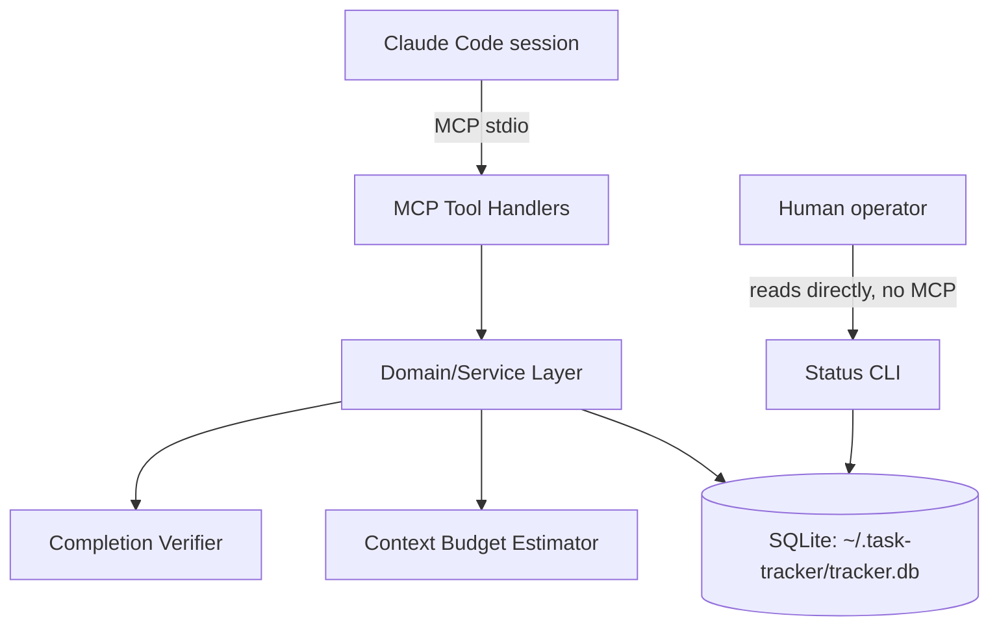
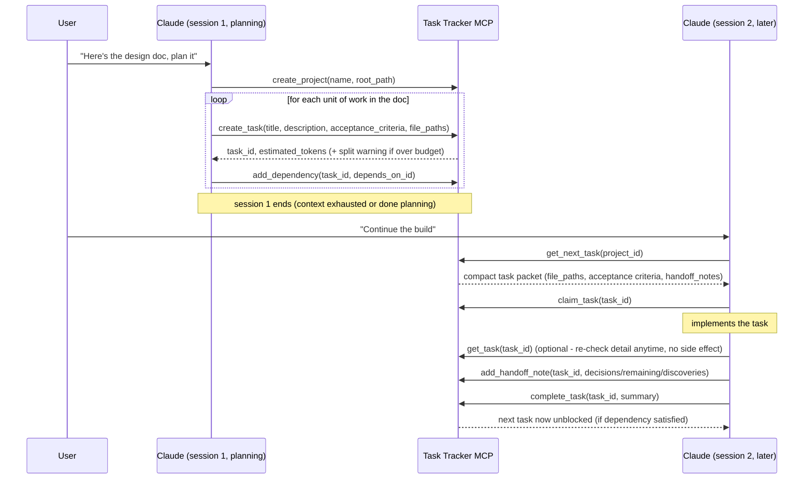
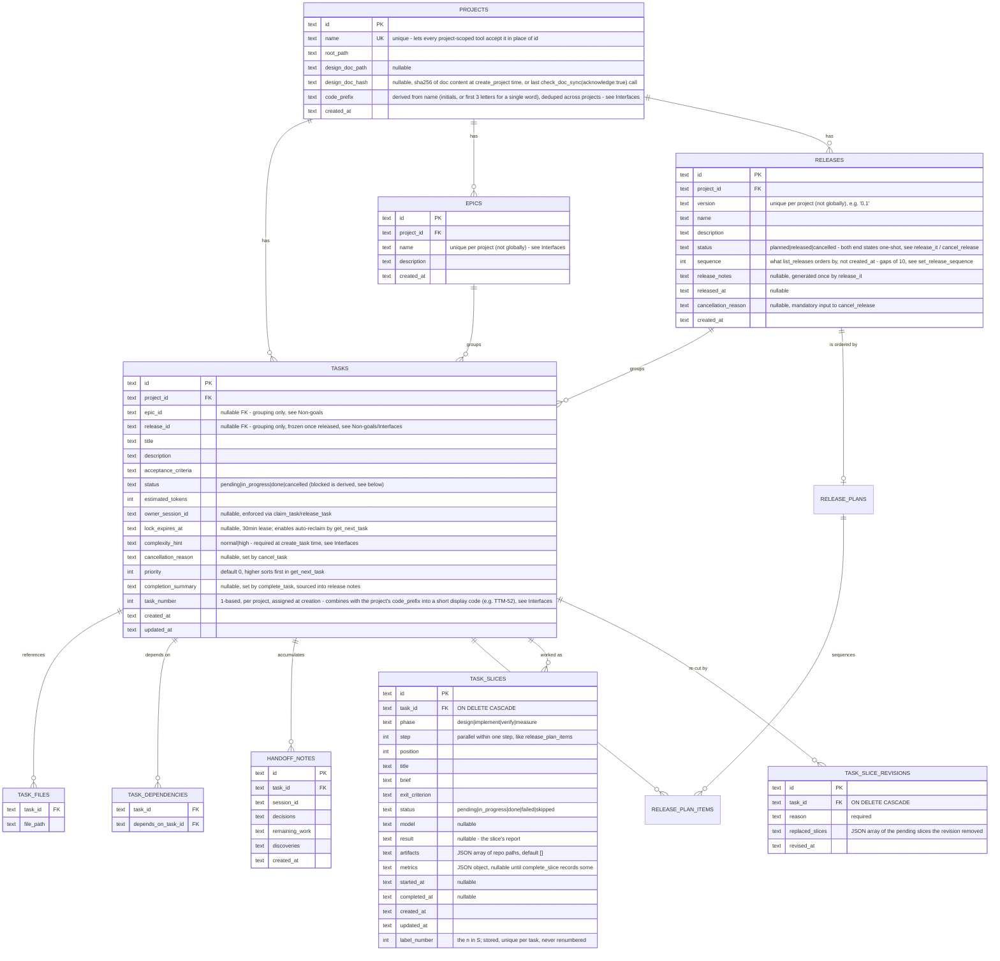

# Task Tracker MCP Server

## Context & Problem

Claude Code builds large applications across many context-limited sessions. Generic
issue trackers (GitHub Issues, Linear, Jira) don't understand context budgets, don't
link tasks to the files an agent needs, and return human-oriented data that wastes
tokens. This project is a local MCP server, purpose-built for agent-driven
development, that Claude Code connects to from any project to plan, size, sequence,
and hand off work across sessions.

## Goals / Non-goals

**Goals**
- Let Claude build a task graph (with dependencies) directly from a design doc, via
  MCP tool calls it makes itself — no server-side document parsing.
- Give each task an explicit file/module list so a new session doesn't have to
  rediscover it.
- Estimate the context cost of a task and support splitting tasks that are too big.
- Return compact, pre-filtered MCP responses (not human-issue-tracker formatting).
- Resolve "what's the next task" strictly from the dependency graph.
- Persist structured handoff notes (decisions, remaining work, discoveries) per task,
  so a fresh session resumes from a summary instead of re-deriving context.
- Work across multiple projects from one running server instance.

**Non-goals**
- Automatically re-planning the task graph when the design doc changes — v2 added
  drift *detection* (`check_doc_sync`), and v5 made drift impossible to silently
  miss by surfacing it on `get_next_task`/`get_project_status` (`doc_drift`) with
  an `acknowledge` step to clear it once reconciled, but re-deriving *what actually
  changed* and applying it to the graph is still a manual, Claude-driven step —
  the server never diffs doc content or generates/edits tasks on its own (see
  Interfaces, Failure Modes).
- A **writable** UI — v2 added a minimal read-only status CLI, and v6 added a
  live, auto-refreshing read-only web dashboard (see Interfaces) that closes
  the original "no interactive viewer" gap, but it still has zero interaction
  with the tracker itself: no clicking a card to claim/complete/edit anything.
  Planning and executing tasks stays exclusively Claude's job through the MCP
  tools above — the dashboard is purely an observability window onto that same
  state, not a second way to change it.
- Epics participating in scheduling — v3 added epics as a pure grouping/reporting
  layer (`create_epic`, `list_epics`, `get_epic_status`, `epic_id` on tasks), but
  epics don't enter the dependency graph, can't depend on each other, and
  `get_next_task` is not epic-aware; they exist so related tasks can be organized
  and reported on together, not to change how work is scheduled.
- ~~Releases participating in scheduling~~ — **reversed in v10 (release plans).** v4 added releases
  as a reporting/shipping gate only (grouped *by version*, orthogonal to epics
  grouping *by feature*), explicitly not a scheduling unit. Release *plans*
  changed that: `get_next_task(project_id, release_id)` now hands out in an
  approved plan's order and refuses while that plan is unapproved. What is still
  true is the epic half above — epics remain purely organizational, and the
  unscoped `get_next_task(project_id)` is unchanged, so a release only
  participates in scheduling when a caller asks it to.

## Constraints

- Runs locally as a single long-lived process per machine, connected to Claude Code
  over the MCP stdio transport — no network exposure, no auth needed. (The v6
  dashboard is a separate opt-in process that does bind a local HTTP port, but
  only on `127.0.0.1` — see Interfaces.)
- Must serve multiple projects from one server instance (chosen over one-server-
  per-project) so it can be registered once, like the global `CLAUDE.md`.
- Stack: TypeScript/Node.js (official MCP SDK, good ecosystem fit) + SQLite (gives
  transactions and queryable dependency graph without building either from scratch).
- Single operator, single machine — no distributed-systems concerns (no need for the
  server to survive a different machine's crash, no multi-region, etc.).

## Chosen Approach

One MCP server process, one SQLite database at `~/.task-tracker/tracker.db` shared
across all projects (`project_id` as a column, not a separate DB per project). Claude
itself is the "importer": it reads a design doc and calls `create_task` /
`add_dependency` repeatedly — the server never parses markdown, which keeps it simple
and keeps task quality tied to Claude's own understanding of the doc rather than a
brittle parser. A thin domain/service layer sits between the MCP tool handlers and
SQLite so the business logic (graph resolution, budget estimation) is testable
independent of the MCP transport.

## Components

- **MCP Tool Handlers** — thin adapters: validate input, call the domain layer,
  shape the compact response. No business logic here.
- **Domain/Service Layer** — task CRUD, dependency graph resolution ("next
  unblocked task"), split/merge logic, handoff-note persistence. Framework-agnostic,
  unit-testable without an MCP client.
- **Context Budget Estimator** — given a task's `file_paths`, estimates token cost
  (chars-on-disk / 4 as a first heuristic) and flags tasks over a configurable
  threshold (e.g. 15k tokens) as "should split" in tool responses. Isolated behind
  an interface so the heuristic can be swapped later without touching callers.
- **Completion Verifier** — pluggable check (`GitDiffCompletionVerifier`) that
  `complete_task` runs before accepting a Claude-declared completion: confirms the
  task's declared files changed, and, if a `test_command` was given, that it exits
  zero. `force: true` skips it. The bar is **any**, not each - both git calls are
  made once over the whole declared list, so a task declaring three files passes
  once one of them is touched. It passes if any declared file is dirty in the
  working tree/index (`git status --porcelain`) **or** the newest HEAD-reachable
  commit touching any of them was committed at or after the task's `created_at`
  (`git log -1 --format=%cI`, committer date). The commit half exists because the working-tree
  half alone fires backwards on a project whose branch workflow requires
  committing: it passes on work-in-progress and fails on finished work, so every
  real completion had to be forced. It accepts a known false positive in
  exchange — commits aren't attributed to tasks, so *any* commit after the task's
  creation that touches a declared file counts, whoever made it — and bounds on
  `created_at` rather than the claim timestamp, since `claim_task` renews the
  lease on every re-claim/hand-off and a claim-time bound could land after the
  very commits it's meant to find. Isolated behind a `CompletionVerifier`
  interface the same way the Budget Estimator isolates its heuristic.
- **Status CLI** (`src/cli/status.ts`) — a standalone script that opens the SQLite
  file directly and calls the same domain functions (`getProjectStatus`,
  `listTasks`) the MCP tools use, so a human can eyeball progress without going
  through Claude or the MCP transport at all.
- **SQLite** — single file, WAL mode (safe concurrent reads, serialized writes).

## Data Flow

## Data Model

A release may have one **plan**: the execution order for its batch, plus the
record that a human approved it. The order itself was always expressible
(`tasks.priority` and `task_dependencies`); what a plan adds is an *approval*,
which an integer cannot carry — approved once, a batch can be worked end to end
instead of stopping every few tasks to re-earn permission. `release_plans` holds
`status` (`draft`/`approved`), `rationale`, and `approved_by`/`approval_note`/
`approved_at`; `release_plan_items` places each task at a `step` (items sharing
one may run in parallel) and a `position` within it.

Two things are deliberately *not* stored there. **Drift** — a batch task missing
from the plan, or a plan item whose task has left the batch — is computed at read
time, for the same reason `blocked` is; a stored flag would disagree with the
graph the moment either changed. And **"new since approval"** is
`item.added_at > plan.approved_at`, so nothing has to be cleared on each
approval. `status` has only two values because reverting an approved plan to
`draft` *is* the supersede mechanism; adding a third would need the
CHECK-widening table rebuild `schema.ts` already carries twice.

A task's own work is recorded the same shape (TTM-83): `task_slices` places
each slice at a `step` (parallel within one, exactly like
`release_plan_items`) and a `position`, with a `phase`
(`design`/`implement`/`verify`/`measure`), the `brief`/`exit_criterion` it was
given, and the `result`/`artifacts`/`metrics` it reports back.
`set_task_slices` writes the first slicing (replaceable wholesale only while
every slice is still pending); `revise_task_slices` (TTM-89) re-cuts the rest
of a task once work has run: it deletes only the pending slices, inserts the
new ones in steps after the highest kept step, and leaves every
`in_progress`/`done`/`failed`/`skipped` row untouched, so a finding that forced
the re-cut survives it. Each revision appends a `task_slice_revisions` row —
the required `reason` plus the replaced pending slices as JSON, modelled on
`task_amendments` — which `get_task` returns as `slice_revisions`.

A slice's readable label (`S<label_number>`) is **stored**, not computed. It
used to be computed at read time from step/position order, which was safe only
while a slicing could be replaced solely as a whole. A revision removes pending
rows while keeping later ones, so a computed label would renumber a kept slice
whenever a pending slice before it went — and a ref like `GM-401/S2` already
written into a commit would silently start naming a different slice. So a
first slicing is numbered 1..n in step/position order, a revision numbers its
new slices after the highest label the task had before it (the replaced ones'
included, so no label is reused for different work), and nothing ever updates
`label_number`. The cost is gaps (`S1, S3, S4, S7`), which is the honest
picture of a re-cut. The alternative — refusing a revision that would renumber
a kept slice — would forbid exactly the common case (an early parallel slice
still pending beside one that ran). `runMigrations` adds the column to older
databases and backfills each unlabelled task with the numbers the read-time
scheme showed, so existing refs keep resolving; `idx_task_slices_label`
enforces uniqueness per task. `artifacts` defaults to `[]` and `metrics` stays `NULL` until
`complete_slice` records some, so "never measured" stays distinguishable from
"measured, nothing to report".

`status = blocked` is derived, not stored authoritatively — `get_next_task` and
`list_tasks` compute it from unmet dependencies at query time, so it can't drift out
of sync with the graph; a `cancelled` prerequisite resolves a dependent the same way
a `done` one does. An epic's or release's status is derived the same way: it's an
aggregate (`get_epic_status`/`list_epics`, `get_release_status`/`list_releases`) over
its tasks' computed statuses, never stored on the epic/release itself — except a
release's own `planned`/`released`/`cancelled` status, `release_notes` and
`cancellation_reason`, which genuinely are stored, since `release_it` and
`cancel_release` are one-shot actions with a real before/after (like
`complete_task` has no "un-complete", a release has no "un-release" and no
"un-cancel"). `cancelled` exists because a batch that was built but deliberately
not shipped can't be expressed by an aggregate at all: its tasks are all `done`,
so every derived signal says "ready", and without the stored status it sits at
100% `planned` forever.

## Interfaces

All responses are compact JSON — no HTML/markdown formatting, no metadata Claude
didn't ask for.

Everywhere a `project_id` parameter is listed below, it accepts either the
project's id **or** its unique `name` — `requireProject` (in the domain layer)
resolves either form, so Claude doesn't need to remember a UUID once a project
has been created. `list_projects` exists specifically to make that name
discoverable.

- `create_project(name, root_path, design_doc_path?) -> { project_id, design_doc_hash }` — pass `design_doc_path` (relative to `root_path`) to hash it now and enable later `check_doc_sync` calls. Rejects with an error if `name` is already in use (see Data Model).
- `list_projects() -> { projects: [{ id, name, root_path }] }` — lets Claude or a human look up a project's id/name without going around the MCP server.
- `create_epic(project_id, name, description?) -> { epic_id }` — `name` must be unique within the project (not globally, unlike project names — the same epic name can repeat across different projects).
- `list_epics(project_id) -> { epics: [{ id, name, description, total, done, in_progress, blocked, pending, cancelled, percent }] }` — status counts are aggregated per epic in the same call, no follow-up needed per epic.
- `get_epic_status(project_id, epic_id) -> { id, name, total, done, in_progress, blocked, pending, cancelled, percent }` — `epic_id` accepts an epic id or its name within that project (mirrors the project id-or-name convention).
- `create_release(project_id, version, name?, description?) -> { release_id }` — `version` must be unique within the project (same "unique per project, not globally" rule as epic names). A release groups tasks *by shipment*, orthogonal to an epic grouping *by feature* — the same task can belong to one of each.
- `list_releases(project_id) -> { releases: [{ id, version, name, description, status, released_at, cancellation_reason, total, done, in_progress, blocked, pending, cancelled, percent }] }` — ordered by `sequence`, not creation time (see Data Model); status counts aggregated per release in the same call.
- `get_release_status(project_id, release_id) -> { id, version, name, status, cancellation_reason, total, done, in_progress, blocked, pending, cancelled, percent }` — `release_id` accepts a release id or its version within that project.
- `release_it(project_id, release_id, test_command?, force?) -> { ok: true, release_notes, released_at } | not_all_done error | verification_failed error` — one-shot (rejects if already `released` or `cancelled`). Gates on every task in the release being `done` or `cancelled` first (**not** skippable by `force` — `{ error: "not_all_done", message, pending_task_ids }`); then on a test run — `test_command` is required unless `force: true` (omitting both is an error, not a silent pass), and when given is run through the *same* Completion Verifier `complete_task` uses (with an empty file list, so only the test command runs — no separate "release verifier"). Generates `release_notes` from the release's `done` tasks (`- title: completion_summary`) plus a `Cancelled:` section for its `cancelled` ones (`- title: reason`), and stores it on the release alongside `released_at`.
- `cancel_release(project_id, release_id, reason) -> { ok: true }` — records a release as built-but-deliberately-not-shipped (a gate said don't ship it, a branch that will never be merged), so it stops sitting on the board as an unfinished `planned` release with every task `done`. The `release_it` counterpart to what `cancel_task` is to `complete_task`. `reason` is **mandatory**, unlike `cancel_task`'s: a whole batch of finished work being written off is only worth recording *with* the why, and it's also all the dashboard has for that lane (a cancelled release never reaches `release_it`, so it has no `release_notes`). One-shot — rejects a release that's already `released` or already `cancelled`, and there is no un-cancel. Leaves the release's tasks untouched, including still-open ones: the membership is the record of what was abandoned.
- `set_task_release(task_id, release_id: string | null) -> { ok: true }` — moves a task to a different release, or clears it (`null`). Rejects if *either* the task's current release or its target release is already `released` — a released release's task membership is frozen (its `release_notes` were generated once, from exactly those tasks; assigning/removing afterward would silently drift them with nothing to detect it). A `cancelled` release is rejected as a *target* for the same "don't add new work to a closed batch" reason, but moving a task **out of** one is deliberately allowed — rescuing salvageable work into a later release is a real workflow, and there are no generated notes for the membership to drift away from, which is the only reason the outbound direction is frozen for shipped releases at all.
- `set_release_sequence(project_id, release_id, sequence) -> { ok: true }` — reorders where a release shows up in `list_releases` (e.g. slot a hotfix between two existing ones). *Not* blocked by `released` or `cancelled` status — display order is unrelated to the membership-freeze rule above.
- `create_task(project_id, title, complexity_hint, description?, acceptance_criteria?, file_paths?, epic_id?, release_id?, priority?, depends_on?: task_id[]) -> { task_id, estimated_tokens, over_budget: bool }` — `complexity_hint` (`"normal" | "high"`) is **required**, not optional like the rest — forces an explicit judgment call at creation time on whether a task is worth delegating to a stronger subagent (see the project's `CLAUDE.md` "Task delegation" section), so that call isn't re-derived or missed by whichever session later picks the task up. `epic_id`/`release_id` (both optional) accept an id or name/version within `project_id`; each rejects a ref that doesn't exist or belongs to a different project, and `release_id` additionally rejects an already-`released` or `cancelled` release. `priority` (optional, default `0`) — higher sorts first in `get_next_task`.
- `set_task_priority(task_id, priority) -> { ok: true }` — adjusts a task's priority after creation, once its importance turns out different than assumed; deliberately its own single-purpose tool rather than a general "update_task".
- `amend_task(task_id, reason, title?, description?, acceptance_criteria?, file_paths?, complexity_hint?) -> { task_id, amended_fields: [...] }` — corrects a task's own text after creation: a `file_paths` entry that never existed, a title that stopped being true, `acceptance_criteria` that turned out different. It is a general "update_task" of exactly those five fields, which the note on `set_task_priority` above says was deliberately avoided — what makes it safe here is the distinction it enforces: *correcting a fact* (this tool), never *rewriting the deal* silently. Every changed field is snapshotted to `task_amendments` before being overwritten, under the caller's mandatory `reason`; `get_task`'s `amendments` array returns that full history (`field`, `previous_value`, `reason`, `amended_at`), so the text a plan was approved against, or a card someone read before, stays recoverable rather than lost. No status gate — corrects a `pending`, `in_progress`, or `done` task alike, unlike the field-scoped-permissions shape considered and rejected for this (description/acceptance_criteria editable only while `pending`), which cannot express "we learned this task was bigger" at the moment that is usually learned; the amendment trail is what keeps an after-the-fact correction honest instead of that gate. Never writes `release_id` and calls none of the plan-write hooks (`appendTaskToPlan`/`removeTaskFromPlan`/`revertPlanToDraft`) — a text correction is not a batch-membership change, so `planDrift` (computed purely from `release_id` and plan item rows) never sees it, and an approved plan stays approved and undrifted across an amendment of a task it orders. `file_paths`, given, replaces the whole list (compared as a set — reordering the same files is not a change) and recomputes `estimated_tokens` the same way `create_task` does. `priority` is not amendable here; use `set_task_priority`. Rejects a call where every given field already matches its current value.
- `cancel_task(task_id, reason?, force?) -> { ok: true, unblocked_task_ids: [...] } | conflict error` — abandons a task that turns out unnecessary, without the dishonesty of a force-completed `complete_task`. Unblocks dependents the same way `complete_task` does. Rejects with the same conflict shape as `claim_task`/`release_task` if an active lock is held, unless `force: true` (no `session_id` param here, so the check is owner-agnostic — any active lock blocks it, regardless of whose).
- `delete_task(task_id) -> { ok: true }` — hard-deletes a task row outright (cascading to its `task_files`, both directions of `task_dependencies`, and `handoff_notes` via `ON DELETE CASCADE`), for cleaning up a mis-created backlog task rather than leaving a permanent `cancelled` row behind. Restricted to tasks with no `release_id` — a released release's task membership is frozen (same reasoning as `set_task_release`), so a task already in one must be moved out first or cancelled instead. Deliberately no lock/ownership guard beyond that check.
- `add_dependency(task_id, depends_on_task_id) -> { ok: true }` (rejects if it would create a cycle)
- `split_task(task_id, subtasks: [{title, description, acceptance_criteria, file_paths, complexity_hint?, priority?}]) -> { new_task_ids[] }` — original task is replaced; its dependents and dependencies are rewired onto the subtasks, which also inherit its `epic_id`/`release_id`/`complexity_hint`/`priority` (the latter two overridable per subtask). Rejects if the original is already `done` or `cancelled` — splitting a finished/abandoned task would otherwise silently resurrect it.
- `get_next_task(project_id, release_id?) -> { task, doc_drift, ... } | { task: null, reason: "all_done" | "all_blocked" | "plan_not_approved", blocked_on?: [...], doc_drift }` — atomically marks the returned task `in_progress` and gives it a 30-minute lock lease as part of the same transaction that selects it (see Failure Modes for both the no-duplicate-hand-out guarantee and stale-lock reclaim). `task` is the full detail packet (see `get_task` below), not just the bare row. `doc_drift: true` means the tracked design doc changed since its hash was last captured — see `check_doc_sync`.
  - **Without `release_id`** — unchanged: project-wide, `priority DESC, created_at ASC`, not epic-aware. It gains one reported field, `plan_pending`, naming any batch whose plan is `draft` or drifted, so an unscoped call cannot quietly bypass a plan without saying so in its own answer.
  - **With `release_id`** (an id or a version) — scoped to that batch, and `plan_status` says which of four situations applies. An `approved`, undrifted plan is walked `step ASC, position ASC`, skipping done/cancelled and live leases and still gated by unmet dependencies. A `draft` or drifted plan returns `plan_not_approved` and hands out nothing — the enforcement that makes a plan followed rather than merely displayed. A batch with no plan falls back to priority order within that batch.
  - Plan order is a **single pass**, so a reclaimable step-1 task beats a fresh pending step-2 one — where the unscoped path drains all pending work before reclaiming anything. The plan says step 1 first.
- `create_plan(project_id, release_id, steps, rationale?) -> ReleasePlan` — writes or replaces a batch's execution order. `steps` is a flat list of task refs (each becoming a step of one, the common case) or a list of groups whose members may run in parallel; a ref is a uuid or a code (`TTM-63`). Upsert rather than separate insert/move/remove tools, because a membership change already sends the plan back to `draft`, which makes re-sending the whole plan the normal path. Replacing an approved plan resets it to `draft` and clears the approval and rationale — nobody signed off on the new order. Rejects a released or cancelled release, a task not in this batch, a task listed twice, and an empty list.
- `get_plan(project_id, release_id) -> ReleasePlan | null` — items in execution order each with its *live* status, the approval record, and both directions of drift. `null` rather than an error when no plan exists, matching `get_task`/`get_release`.
- `approve_plan(project_id, release_id, approved_by, note?) -> ReleasePlan` — `draft -> approved`. `note` is stored exactly as given: the approving human's verbatim words, not a summary, because the party an approval authorises is the party calling the tool and a quote is the only part of that record which is checkable afterwards. Refuses a drifted plan (the error names the offending tasks by code — it is the reader's cue to re-approve), then — TTM-87 — refuses while any open batch task (status not `done`/`cancelled`) has zero slices, naming them by code and pointing at `set_task_slices` (see Failure Modes), and an already-approved plan (no re-stamping over the first approver).
- `get_task(task_id) -> { id, title, description, acceptance_criteria, status, estimated_tokens, priority, complexity_hint, file_paths, handoff_notes, amendments, slices, ... }` — the same detail packet `get_next_task` returns, fetchable anytime with no claim/lock side effect; use this (not `get_next_task`) to just re-inspect a task. `amendments` (see `amend_task`) is that task's full correction history, oldest first, empty when it was never amended. `slices` (see `set_task_slices`) is how the task is worked, in step/position order, empty for a task nobody has sliced yet. `slice_revisions` (see `revise_task_slices`) is its re-slicing history, oldest first, empty when it was never revised.
- `set_task_slices(task_id, slices: Array<Slice | Slice[]>) -> { task_id, code, slices }` — writes a task's first slicing: how it's worked, as an ordered sequence of steps, each a slice or an array of slices sharing a step that may run in parallel (the task-level analogue of `create_plan`'s steps, deliberately the same shape). A slice is `{phase: design|implement|verify|measure, title, brief?, exit_criterion?, model?}`. Slices are labelled `S1`, `S2`, ... in step/position order and returned with a `ref` (e.g. `TTM-83/S2`) that `start_slice`/`complete_slice` accept in place of a uuid. While every slice is still `pending` it may be called again, replacing the slicing wholesale and renumbering from `S1`. Refuses once any slice is `in_progress`/`done`/`failed`/`skipped`, naming each and pointing at `revise_task_slices`, and on a `done`/`cancelled` task, whose slicing is a finished record (see Failure Modes). `task_id` accepts a uuid or a code (`TTM-63`).
- `revise_task_slices(task_id, slices: Array<Slice | Slice[]>, reason) -> { task_id, code, slices, revision }` — re-cuts the rest of a task (TTM-89). Replaces only its `pending` slices with `slices` (same step shape as `set_task_slices`); every `done`/`failed`/`skipped`/`in_progress` slice is kept untouched — status, result, artifacts, metrics, timestamps, step, position and label. The new slices go in steps after the highest kept step and are labelled after the highest label the task already had, so no existing label changes or is reused (labels may have gaps). `reason` is required; `revision` is `{id, task_id, reason, replaced_slices, revised_at}`, where `replaced_slices` holds each replaced pending slice's `id`, `label`, `phase`, `step`, `position`, `title`, `brief`, `exit_criterion` and `model`, and every revision is returned by `get_task` as `slice_revisions`. Refuses on a `done`/`cancelled` task. `task_id` accepts a uuid or a code.
- `start_slice(slice_id) -> TaskSlice` — `pending -> in_progress`, stamping `started_at`. Refuses any slice that isn't `pending`. `slice_id` accepts a slice's own uuid or `<task>/S<n>` (e.g. `TTM-83/S2`, or `<task uuid>/S2`) — the `ref` every slice carries, fixed for the slice's life.
- `complete_slice(slice_id, status: done|failed|skipped, result, artifacts?, metrics?) -> TaskSlice` — records a slice's outcome and report, stamping `completed_at`. `done`/`failed` require the slice to be `in_progress` (they report on work that ran, and `started_at` is half its duration); `skipped` is also accepted straight from `pending` — the normal case for a slice that never ran. One-shot like `complete_task`: an already finished slice is refused, never overwritten (see Failure Modes). `result` is the slice's report; `artifacts` (optional) the repo paths of its durable outputs; `metrics` (optional) a free-form object (e.g. `reread_tokens`, `max_context`, `tool_uses`, `duration_ms`).
- `claim_task(task_id, session_id) -> { ok: true } | conflict error | blocked error | not_claimable error` — takes a specific task into work directly: moves a `pending` task straight to `in_progress` (the direct-pick counterpart to `get_next_task`'s queue-pull, for a human/orchestrator assigning a specific task to a specific parallel worker), or attaches/renews ownership on a task already `in_progress` (e.g. right after `get_next_task`). Rejects with `{ error: "conflict", current_owner_session_id, lock_expires_at }` if a different session's lock is still active, `{ error: "blocked", message }` if the task is `pending` with unmet dependencies (same gate `get_next_task`'s candidate query applies), or `{ error: "not_claimable", message, status }` if it's already `done`/`cancelled`.
- `release_task(task_id, session_id, force?) -> { ok: true } | conflict error` — gives up ownership immediately (back to `pending`) instead of waiting out the lease; `force: true` overrides another session's still-active lock.
- `check_doc_sync(project_id, acknowledge?) -> { tracked, in_sync, design_doc_path, stored_hash, current_hash }` — compares the tracked design doc's current hash against the one captured at `create_project` time (or the last `acknowledge`); `tracked: false` means no doc was ever registered. Pass `acknowledge: true` once the graph has been manually reconciled with the doc's new content to persist the current hash as the new baseline *in place* (no need to re-run `create_project`); a no-op if untracked or the doc can't currently be read.
- `add_handoff_note(task_id, session_id, { decisions, remaining_work, discoveries }) -> { ok: true }`
- `complete_task(task_id, summary?, test_command?, force?) -> { ok: true, unblocked_task_ids: [...] } | open_slices error | verification_failed error` — refuses with `open_slices` while any of the task's slices (see `set_task_slices`) is still `pending`/`in_progress`, naming each one (see Failure Modes); then runs the Completion Verifier (declared files changed + `test_command` exits zero, if given). `force: true` skips both. `summary`, if given, is persisted as `completion_summary` — the source text `release_it` pulls into generated release notes.
- `get_project_status(project_id) -> { total, done, in_progress, blocked, pending, cancelled, percent, doc_drift }` — `doc_drift` mirrors `get_next_task`'s (see `check_doc_sync`).
- `list_tasks(project_id, status?, epic_id?, release_id?) -> { tasks: [{ id, title, status, estimated_tokens, task_number, epic_id, release_id }] }` — summary rows only; use `get_task` for full detail. `epic_id`/`release_id` (both optional, combinable) scope the list to one epic and/or one release.
- **Status CLI** (outside MCP): `node dist/cli/status.js [project_id_or_name]` — no arg lists every registered project's status; with an arg, prints that project's status plus its full task list. Read-only, opens the DB directly.
- **Dashboard** (outside MCP): `npm run dashboard` starts a read-only local web server (`src/dashboard/server.ts`, plain `node:http`, no new dependency) bound to `127.0.0.1` only (port from `TASK_TRACKER_DASHBOARD_PORT`, default `4321`) — opens the DB the same way the Status CLI does, no MCP round-trip. Serves a project picker (`/`) and a per-project board (`/board.html?project=<id>`), plus the JSON API they poll: `GET /api/projects -> { projects: [{id, name}] }` and `GET /api/projects/:id/board -> BoardData` (`getBoardData` in `src/domain/board.ts` — tasks grouped into release swimlanes, the "no release" (Backlog) lane always first even when empty, remaining lanes newest-release-first; each task shaped with title/description/status/priority/epic_name/owner_session_id/is_stale/task_number, plus a per-board `project_code_prefix`; no new schema, purely derived from existing tables). The board page polls that endpoint every 1.5s and re-renders, showing a `doc_drift` banner, a "last updated"/disconnected indicator, click-to-collapse per-release swimlanes (each lane's title annotated with its non-cancelled task count, e.g. "Backlog (5)"; a `released` or `cancelled` lane defaults to collapsed, and a cancelled one gets a red `--danger` header, a `Cancelled` badge and its reason behind the same dialog release notes use — deliberately *louder* than a cancelled task's grey/struck-through card, since a whole abandoned batch is the thing a reader most needs to notice), per-card click-to-expand descriptions (hidden by default - only status/priority/epic/owner show at a glance; both collapse states are in-memory only, not persisted), and each card's title prefixed with its `PREFIX-N` display code (`project_code_prefix` + `task_number`, e.g. "TTM-52"). A lane whose release has a plan also gets a **Plan** button beside Release notes, opening a dialog that lists the plan's steps in order with each item's title joined from the lane's own tasks (the payload carries the *ordering* only, never a second copy of a title or status), done and cancelled items struck through, the approval header quoting the approver's own words, and a drift warning naming the tasks the plan fails to cover. It is read-only like the rest of the dashboard — deliberately **no Approve button**, since approval happens in chat through `approve_plan`; that message is therefore the whole interface for the failure, which is why its wording is pinned by a test. `POST /api/shutdown -> { ok: true }` is the one intentional non-GET route - closes the process shortly after responding (both pages have a "Stop dashboard" button wired to it); still doesn't touch the tracker DB, it only ends the dashboard's own process. On startup, `main()` also shells out to the OS's default-URL-open command (`open`/`xdg-open`/`start` - `src/dashboard/openBrowser.ts`) to open the picker page automatically, reusing an already-open browser/tab the same way any OS URL-open does; set `TASK_TRACKER_DASHBOARD_NO_OPEN` to skip it (headless/SSH usage). A failed open (e.g. no `xdg-open`) just logs a warning - never takes the server down.

## Failure Modes & Edge Cases

- **Two `get_next_task` calls race on the same project.** Selection and the
  `pending -> in_progress` status flip happen inside one SQLite transaction, so the
  same task can't be handed out twice even without full ownership semantics. This is
  the minimum needed to not actively break if the user ever runs two sessions —
  richer conflict handling (stale-lock timeout, explicit reassignment) is v2.
- **Server process crash mid-write.** WAL mode + transactional writes mean the DB
  never sees a half-written task; on restart, state is exactly what was last
  committed.
- **A task's estimate turns out wrong once work starts.** Claude calls `split_task`;
  the remainder becomes new pending tasks that inherit the original's dependency
  edges, so the graph stays consistent.
- **A session dies mid-task without completing or splitting it.** `get_next_task`
  hands out a task with a 30-minute lock lease (`LOCK_LEASE_MS`); once that expires,
  a later `get_next_task` call automatically reclaims it (clearing the dead
  session's `owner_session_id`) instead of leaving it stuck `in_progress` forever.
- **Two sessions want the same in-flight task.** `claim_task`/`release_task` reject
  with a `conflict` error (`current_owner_session_id`, `lock_expires_at`) while
  another session's lock is still active; `release_task(force: true)` overrides it.
- **`claim_task` is called directly on a task that isn't free to start.** A
  `pending` task with unmet dependencies rejects with a `blocked` error (same
  dependency gate `get_next_task` applies) instead of silently sitting `pending`
  with an owner attached and no status change; an already `done`/`cancelled` task
  rejects with a `not_claimable` error.
- **None of a `complete_task` call's declared files were dirty, nor touched by a
  commit since the task was created.** `complete_task` rejects with
  `verification_failed` (reason included) unless `force: true` is passed — see
  Completion Verifier in Components. A task created *after* its work was already
  committed still fails this check, correctly: `created_at` postdates the commit.
- **Design doc changes after the graph exists.** `check_doc_sync` detects the drift
  (doc hash no longer matches); `get_next_task`/`get_project_status` also report
  `doc_drift: true` on every call from then on, so it can't be silently missed on
  a long-running project the way a one-off `check_doc_sync` call could be. The
  graph itself is never touched automatically — Claude re-plans by hand and then
  calls `check_doc_sync(acknowledge: true)` to clear the flag (see Non-goals).
- **`add_dependency` would create a cycle.** Rejected synchronously with an error;
  the domain layer checks reachability before writing.
- **`create_project` is called with a name already in use.** Rejected with a
  clear error (`Project name already in use: ...`) rather than a raw SQLite
  constraint message, since `projects.name` is unique (see Data Model) and every
  other tool relies on that to resolve a project by name.
- **A project-scoped tool is called with an id or name that doesn't exist.**
  `requireProject` raises a clear error (`Unknown project: ...`) immediately,
  rather than the pre-v3 behavior of silently treating an unrecognized id as an
  empty/all-done project.
- **`release_it` is called before every task in the release is resolved.**
  Rejects with a distinct `not_all_done` shape (`pending_task_ids` included) —
  deliberately not skippable by `force`, unlike the test gate (see Interfaces).
- **`release_it` is called without a `test_command` and without `force`.**
  Rejected as `verification_failed` rather than silently passing — an earlier
  version of this design let an omitted `test_command` skip testing entirely,
  which defeated the point of the gate.
- **An already-existing `~/.task-tracker/tracker.db` predates the `cancelled`
  status.** Its `tasks.status` CHECK constraint is baked in at the SQLite schema
  level and can't be widened via `ALTER TABLE` — `runMigrations` rebuilds the
  table in place (rename, recreate with the widened CHECK, copy rows, drop the
  renamed original) inside an `IMMEDIATE` transaction, so the MCP server and the
  Status CLI can't race through it if both start right after an upgrade.
- **The same DB predates the `cancelled` *release* status.**
  `widenReleaseStatusCheck` rebuilds `releases` the identical way, with one
  extra hazard: `tasks.release_id` is `REFERENCES releases(id) ON DELETE SET
  NULL`, so dropping the renamed original with `foreign_keys` still on would
  silently clear *every* task's release assignment — no error, no constraint
  failure, and the rows all still there afterwards. Both `foreign_keys = OFF`
  (toggled outside the transaction, since SQLite ignores the pragma inside one)
  and `legacy_alter_table = ON` (so the RENAME doesn't repoint `tasks`' stored
  FK clause at `releases_old`) are load-bearing, and `tests/migration.test.ts`
  asserts the task→release links survive rather than only that the rows do.
- **`complete_task` is called while the task still has slices pending or in
  progress.** Rejected with `open_slices`, naming each open slice as
  `describeSlice` formats it (`S2 "title" (pending)`), rather than accepted
  with unfinished work silently implied done — a task is worked as its slices,
  so "done" while some of them never ran is a claim the record would
  contradict. `force` skips this the same way it skips verification.
- **`set_task_slices` is called on a task with a slice that has started or
  finished, or on one that's `done`/`cancelled`.** Both refuse rather than
  silently discarding live work or rewriting a finished record: a slice
  `in_progress` means some agent is working it right now, and deleting the row
  under it would make its `complete_slice` fail and lose the report; a
  `done`/`failed`/`skipped` slice holds a report and metrics — often the very
  finding that made a re-slice necessary — and wholesale replacement would
  delete them (before TTM-89 it did, listing them only in a `discarded` field).
  The refusal names each such slice and points at `revise_task_slices`, which
  re-cuts only the pending rest. A `done`/`cancelled` task's slicing is the
  record of how it was worked, and rewriting it afterwards would erase that.
  None of this is bypassable by `force` — `set_task_slices` takes no such
  parameter.
- **`revise_task_slices` is called on a `done`/`cancelled` task, or with an
  empty `reason`.** Refused, changing nothing: the finished task's slicing is
  its record, and a revision without a reason records nothing worth having.
  An `in_progress` slice is *not* a refusal here — it is kept, and its agent's
  `complete_slice` still finds its row under the same label.
- **`start_slice`/`complete_slice` are called on a slice already in the
  target state, or in the wrong one.** Both are one-shot state transitions,
  not idempotent upserts: `start_slice` refuses any non-`pending` slice, and
  `complete_slice` refuses a slice already `done`/`failed`/`skipped` — a
  report cannot be silently replaced by a second call. `done`/`failed`
  additionally require the slice to have been started (`in_progress`);
  `skipped` is the one outcome also reachable straight from `pending`, since a
  slice skipped without ever running is the normal case for a skip.
- **`approve_plan` is called while an open batch task has no slices
  (TTM-87).** Checked inside the same transaction right after the drift check
  above, and only if that one passes: refuses, naming the unsliced tasks by
  code and pointing at `set_task_slices`, the same shape as the drift refusal
  it follows. `done`/`cancelled` tasks are exempt, matching `planDrift`'s own
  exemption of them from the unplanned side — nothing left to slice. No
  `force`/bypass, and the check runs only at approval time, so a plan can
  still be written and reordered before every task is sliced; this and
  `complete_task`'s `open_slices` refusal above thus gate a task's slicing
  from opposite ends of its lifecycle — before the batch is signed off, and
  before the task is declared done.

## Open Questions / Risks

- **Token estimate accuracy.** The chars/4 heuristic is a first cut — if it proves
  too far off in practice (e.g. dense code vs. prose), it's isolated behind the
  Budget Estimator interface and can be swapped for something better without
  touching callers.
- **Doc-sync reconciliation is surfaced automatically, but still applied by hand.**
  `doc_drift` on `get_next_task`/`get_project_status` closes the "forgot to check"
  gap, but Claude still has to re-derive and apply the diff to the graph itself —
  the server doesn't parse or diff doc content. Revisit only if that manual
  re-planning step (as opposed to the *noticing* it, which is now solved) proves
  to be a recurring papercut.
