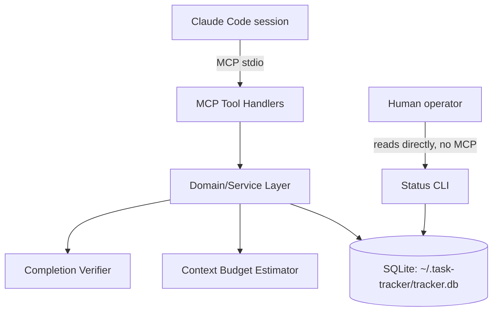
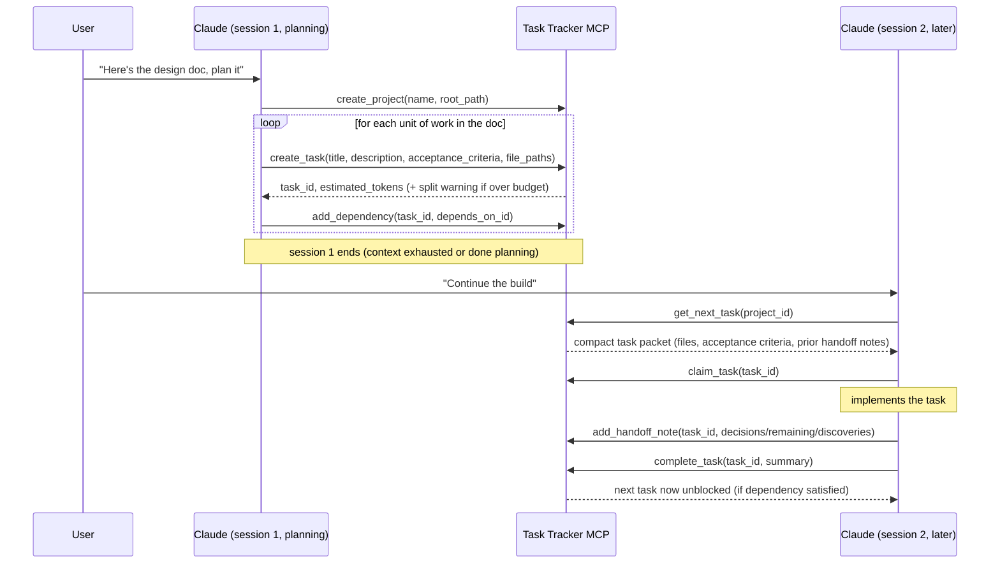
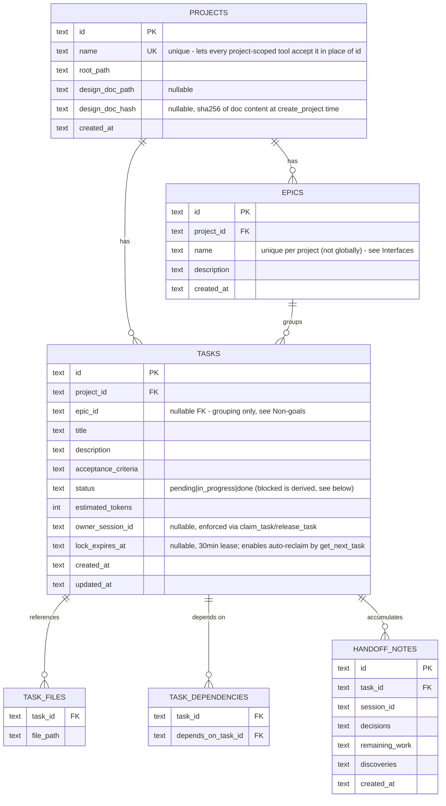

# Task Tracker MCP Server

## Context & Problem

Claude Code builds large applications across many context-limited sessions. Generic
issue trackers (GitHub Issues, Linear, Jira) don't understand context budgets, don't
link tasks to the files an agent needs, and return human-oriented data that wastes
tokens. This project is a local MCP server, purpose-built for agent-driven
development, that Claude Code connects to from any project to plan, size, sequence,
and hand off work across sessions.

## Goals / Non-goals

**Goals**
- Let Claude build a task graph (with dependencies) directly from a design doc, via
  MCP tool calls it makes itself — no server-side document parsing.
- Give each task an explicit file/module list so a new session doesn't have to
  rediscover it.
- Estimate the context cost of a task and support splitting tasks that are too big.
- Return compact, pre-filtered MCP responses (not human-issue-tracker formatting).
- Resolve "what's the next task" strictly from the dependency graph.
- Persist structured handoff notes (decisions, remaining work, discoveries) per task,
  so a fresh session resumes from a summary instead of re-deriving context.
- Work across multiple projects from one running server instance.

**Non-goals**
- Automatically reconciling the task graph when the design doc changes — v2 added
  drift *detection* (`check_doc_sync`, see Interfaces), but Claude still has to be
  told to re-plan the graph itself; that reconciliation step stays manual.
- A full UI/viewer — v2 added a minimal read-only status CLI (see Interfaces), but
  it's a print-and-exit tool, not an interactive viewer.
- Epics participating in scheduling — v3 added epics as a pure grouping/reporting
  layer (`create_epic`, `list_epics`, `get_epic_status`, `epic_id` on tasks), but
  epics don't enter the dependency graph, can't depend on each other, and
  `get_next_task` is not epic-aware; they exist so related tasks can be organized
  and reported on together, not to change how work is scheduled.

## Constraints

- Runs locally as a single long-lived process per machine, connected to Claude Code
  over the MCP stdio transport — no network exposure, no auth needed.
- Must serve multiple projects from one server instance (chosen over one-server-
  per-project) so it can be registered once, like the global `CLAUDE.md`.
- Stack: TypeScript/Node.js (official MCP SDK, good ecosystem fit) + SQLite (gives
  transactions and queryable dependency graph without building either from scratch).
- Single operator, single machine — no distributed-systems concerns (no need for the
  server to survive a different machine's crash, no multi-region, etc.).

## Chosen Approach

One MCP server process, one SQLite database at `~/.task-tracker/tracker.db` shared
across all projects (`project_id` as a column, not a separate DB per project). Claude
itself is the "importer": it reads a design doc and calls `create_task` /
`add_dependency` repeatedly — the server never parses markdown, which keeps it simple
and keeps task quality tied to Claude's own understanding of the doc rather than a
brittle parser. A thin domain/service layer sits between the MCP tool handlers and
SQLite so the business logic (graph resolution, budget estimation) is testable
independent of the MCP transport.

## Components

- **MCP Tool Handlers** — thin adapters: validate input, call the domain layer,
  shape the compact response. No business logic here.
- **Domain/Service Layer** — task CRUD, dependency graph resolution ("next
  unblocked task"), split/merge logic, handoff-note persistence. Framework-agnostic,
  unit-testable without an MCP client.
- **Context Budget Estimator** — given a task's `file_paths`, estimates token cost
  (chars-on-disk / 4 as a first heuristic) and flags tasks over a configurable
  threshold (e.g. 15k tokens) as "should split" in tool responses. Isolated behind
  an interface so the heuristic can be swapped later without touching callers.
- **Completion Verifier** — pluggable check (`GitDiffCompletionVerifier`) that
  `complete_task` runs before accepting a Claude-declared completion: confirms the
  task's declared files actually changed (`git status --porcelain`) and, if a
  `test_command` was given, that it exits zero. `force: true` skips it. Isolated
  behind a `CompletionVerifier` interface the same way the Budget Estimator isolates
  its heuristic.
- **Status CLI** (`src/cli/status.ts`) — a standalone script that opens the SQLite
  file directly and calls the same domain functions (`getProjectStatus`,
  `listTasks`) the MCP tools use, so a human can eyeball progress without going
  through Claude or the MCP transport at all.
- **SQLite** — single file, WAL mode (safe concurrent reads, serialized writes).

## Data Flow

## Data Model

`status = blocked` is derived, not stored authoritatively — `get_next_task` and
`list_tasks` compute it from unmet dependencies at query time, so it can't drift out
of sync with the graph. An epic's status is derived the same way: it's an aggregate
(`get_epic_status`/`list_epics`) over its tasks' computed statuses, never stored on
the epic itself.

## Interfaces

All responses are compact JSON — no HTML/markdown formatting, no metadata Claude
didn't ask for.

Everywhere a `project_id` parameter is listed below, it accepts either the
project's id **or** its unique `name` — `requireProject` (in the domain layer)
resolves either form, so Claude doesn't need to remember a UUID once a project
has been created. `list_projects` exists specifically to make that name
discoverable.

- `create_project(name, root_path, design_doc_path?) -> { project_id, design_doc_hash }` — pass `design_doc_path` (relative to `root_path`) to hash it now and enable later `check_doc_sync` calls. Rejects with an error if `name` is already in use (see Data Model).
- `list_projects() -> { projects: [{ id, name, root_path }] }` — lets Claude or a human look up a project's id/name without going around the MCP server.
- `create_epic(project_id, name, description?) -> { epic_id }` — `name` must be unique within the project (not globally, unlike project names — the same epic name can repeat across different projects).
- `list_epics(project_id) -> { epics: [{ id, name, description, total, done, in_progress, blocked, pending, percent }] }` — status counts are aggregated per epic in the same call, no follow-up needed per epic.
- `get_epic_status(project_id, epic_id) -> { id, name, total, done, in_progress, blocked, pending, percent }` — `epic_id` accepts an epic id or its name within that project (mirrors the project id-or-name convention).
- `create_task(project_id, title, description, acceptance_criteria, file_paths[], epic_id?, depends_on?: task_id[]) -> { task_id, estimated_tokens, over_budget: bool }` — `epic_id` (optional) accepts an epic id or its name within `project_id`; rejects an epic that doesn't exist or belongs to a different project.
- `add_dependency(task_id, depends_on_task_id) -> { ok: true }` (rejects if it would create a cycle)
- `split_task(task_id, subtasks: [{title, description, acceptance_criteria, file_paths}]) -> { new_task_ids[] }` — original task is replaced; its dependents and dependencies are rewired onto the subtasks, which also inherit its `epic_id`.
- `get_next_task(project_id) -> { task } | { task: null, reason: "all_done" | "all_blocked", blocked_on?: [...] }` — atomically marks the returned task `in_progress` and gives it a 30-minute lock lease as part of the same transaction that selects it (see Failure Modes for both the no-duplicate-hand-out guarantee and stale-lock reclaim). Not epic-aware — picks from the whole project's graph regardless of epic (see Non-goals).
- `claim_task(task_id, session_id) -> { ok: true } | conflict error` — records `owner_session_id` and renews the lock lease; rejects with `{ error: "conflict", current_owner_session_id, lock_expires_at }` if a different session's lock is still active.
- `release_task(task_id, session_id, force?) -> { ok: true } | conflict error` — gives up ownership immediately (back to `pending`) instead of waiting out the lease; `force: true` overrides another session's still-active lock.
- `check_doc_sync(project_id) -> { tracked, in_sync, design_doc_path, stored_hash, current_hash }` — compares the tracked design doc's current hash against the one captured at `create_project` time; `tracked: false` means no doc was ever registered.
- `add_handoff_note(task_id, session_id, { decisions, remaining_work, discoveries }) -> { ok: true }`
- `complete_task(task_id, summary, test_command?, force?) -> { ok: true, unblocked_task_ids: [...] } | verification_failed error` — runs the Completion Verifier first (declared files changed + `test_command` exits zero, if given); `force: true` skips it.
- `get_project_status(project_id) -> { total, done, in_progress, blocked, pending, percent }`
- `list_tasks(project_id, status?, epic_id?) -> { tasks: [{ id, title, status, estimated_tokens, epic_id }] }` — summary rows only; use `get_next_task`/a future `get_task` for full detail. `epic_id` (optional) scopes the list to one epic.
- **Status CLI** (outside MCP): `node dist/cli/status.js [project_id_or_name]` — no arg lists every registered project's status; with an arg, prints that project's status plus its full task list. Read-only, opens the DB directly.

## Failure Modes & Edge Cases

- **Two `get_next_task` calls race on the same project.** Selection and the
  `pending -> in_progress` status flip happen inside one SQLite transaction, so the
  same task can't be handed out twice even without full ownership semantics. This is
  the minimum needed to not actively break if the user ever runs two sessions —
  richer conflict handling (stale-lock timeout, explicit reassignment) is v2.
- **Server process crash mid-write.** WAL mode + transactional writes mean the DB
  never sees a half-written task; on restart, state is exactly what was last
  committed.
- **A task's estimate turns out wrong once work starts.** Claude calls `split_task`;
  the remainder becomes new pending tasks that inherit the original's dependency
  edges, so the graph stays consistent.
- **A session dies mid-task without completing or splitting it.** `get_next_task`
  hands out a task with a 30-minute lock lease (`LOCK_LEASE_MS`); once that expires,
  a later `get_next_task` call automatically reclaims it (clearing the dead
  session's `owner_session_id`) instead of leaving it stuck `in_progress` forever.
- **Two sessions want the same in-flight task.** `claim_task`/`release_task` reject
  with a `conflict` error (`current_owner_session_id`, `lock_expires_at`) while
  another session's lock is still active; `release_task(force: true)` overrides it.
- **A `complete_task` call's declared files were never actually touched.**
  `complete_task` rejects with `verification_failed` (reason included) unless
  `force: true` is passed — see Completion Verifier in Components.
- **Design doc changes after the graph exists.** `check_doc_sync` detects the drift
  (doc hash no longer matches), but doesn't touch the graph itself — Claude still
  has to be told to reconcile it manually (see Non-goals).
- **`add_dependency` would create a cycle.** Rejected synchronously with an error;
  the domain layer checks reachability before writing.
- **`create_project` is called with a name already in use.** Rejected with a
  clear error (`Project name already in use: ...`) rather than a raw SQLite
  constraint message, since `projects.name` is unique (see Data Model) and every
  other tool relies on that to resolve a project by name.
- **A project-scoped tool is called with an id or name that doesn't exist.**
  `requireProject` raises a clear error (`Unknown project: ...`) immediately,
  rather than the pre-v3 behavior of silently treating an unrecognized id as an
  empty/all-done project.

## Open Questions / Risks

- **Token estimate accuracy.** The chars/4 heuristic is a first cut — if it proves
  too far off in practice (e.g. dense code vs. prose), it's isolated behind the
  Budget Estimator interface and can be swapped for something better without
  touching callers.
- **Doc-sync reconciliation is still manual.** `check_doc_sync` tells Claude the
  design doc drifted, but doesn't touch the graph itself — Claude still has to
  re-derive and apply the diff by hand. Revisit if that manual step proves to be a
  recurring papercut.
