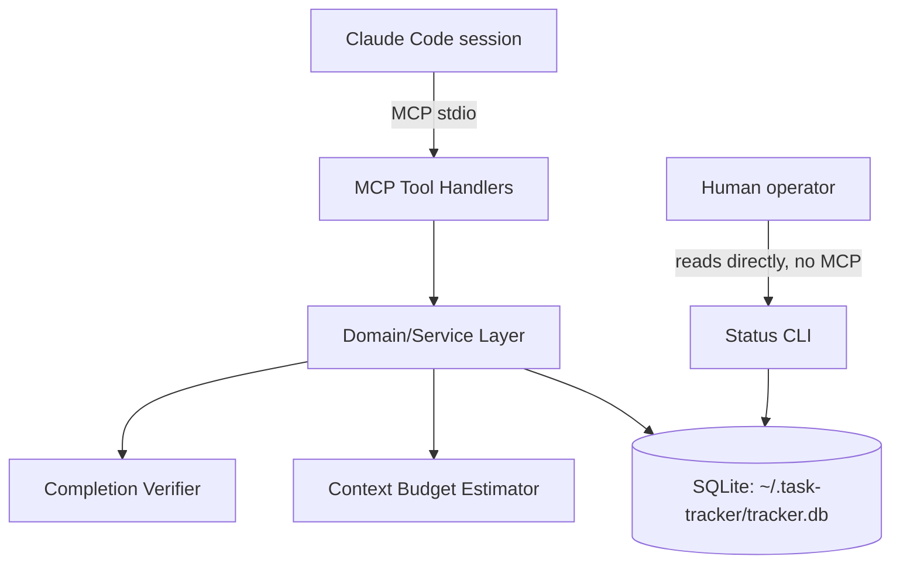
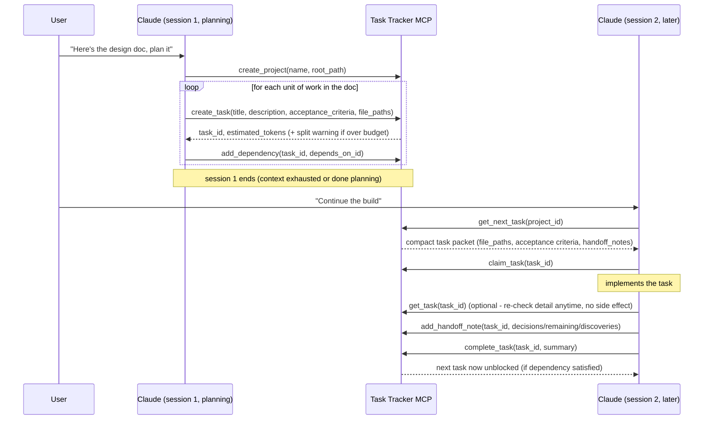
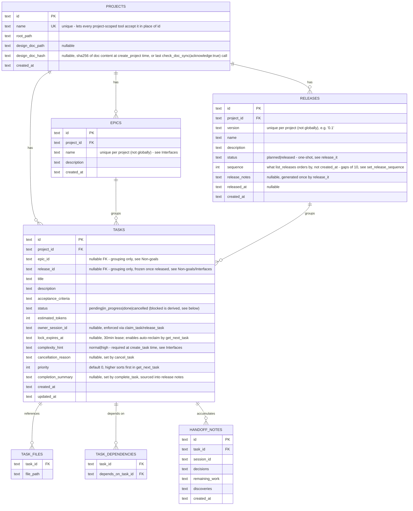

# Task Tracker MCP Server

## Context & Problem

Claude Code builds large applications across many context-limited sessions. Generic
issue trackers (GitHub Issues, Linear, Jira) don't understand context budgets, don't
link tasks to the files an agent needs, and return human-oriented data that wastes
tokens. This project is a local MCP server, purpose-built for agent-driven
development, that Claude Code connects to from any project to plan, size, sequence,
and hand off work across sessions.

## Goals / Non-goals

**Goals**
- Let Claude build a task graph (with dependencies) directly from a design doc, via
  MCP tool calls it makes itself — no server-side document parsing.
- Give each task an explicit file/module list so a new session doesn't have to
  rediscover it.
- Estimate the context cost of a task and support splitting tasks that are too big.
- Return compact, pre-filtered MCP responses (not human-issue-tracker formatting).
- Resolve "what's the next task" strictly from the dependency graph.
- Persist structured handoff notes (decisions, remaining work, discoveries) per task,
  so a fresh session resumes from a summary instead of re-deriving context.
- Work across multiple projects from one running server instance.

**Non-goals**
- Automatically re-planning the task graph when the design doc changes — v2 added
  drift *detection* (`check_doc_sync`), and v5 made drift impossible to silently
  miss by surfacing it on `get_next_task`/`get_project_status` (`doc_drift`) with
  an `acknowledge` step to clear it once reconciled, but re-deriving *what actually
  changed* and applying it to the graph is still a manual, Claude-driven step —
  the server never diffs doc content or generates/edits tasks on its own (see
  Interfaces, Failure Modes).
- A **writable** UI — v2 added a minimal read-only status CLI, and v6 added a
  live, auto-refreshing read-only web dashboard (see Interfaces) that closes
  the original "no interactive viewer" gap, but it still has zero interaction
  with the tracker itself: no clicking a card to claim/complete/edit anything.
  Planning and executing tasks stays exclusively Claude's job through the MCP
  tools above — the dashboard is purely an observability window onto that same
  state, not a second way to change it.
- Epics participating in scheduling — v3 added epics as a pure grouping/reporting
  layer (`create_epic`, `list_epics`, `get_epic_status`, `epic_id` on tasks), but
  epics don't enter the dependency graph, can't depend on each other, and
  `get_next_task` is not epic-aware; they exist so related tasks can be organized
  and reported on together, not to change how work is scheduled.
- Releases participating in scheduling — v4 added releases (`create_release`,
  `list_releases`, `get_release_status`, `release_it`, `release_id` on tasks), the
  same non-goal as epics above: a release is a reporting/shipping gate (grouped
  *by version*, orthogonal to epics grouping *by feature*), not a scheduling unit.
  `get_next_task` is not release-aware either.

## Constraints

- Runs locally as a single long-lived process per machine, connected to Claude Code
  over the MCP stdio transport — no network exposure, no auth needed. (The v6
  dashboard is a separate opt-in process that does bind a local HTTP port, but
  only on `127.0.0.1` — see Interfaces.)
- Must serve multiple projects from one server instance (chosen over one-server-
  per-project) so it can be registered once, like the global `CLAUDE.md`.
- Stack: TypeScript/Node.js (official MCP SDK, good ecosystem fit) + SQLite (gives
  transactions and queryable dependency graph without building either from scratch).
- Single operator, single machine — no distributed-systems concerns (no need for the
  server to survive a different machine's crash, no multi-region, etc.).

## Chosen Approach

One MCP server process, one SQLite database at `~/.task-tracker/tracker.db` shared
across all projects (`project_id` as a column, not a separate DB per project). Claude
itself is the "importer": it reads a design doc and calls `create_task` /
`add_dependency` repeatedly — the server never parses markdown, which keeps it simple
and keeps task quality tied to Claude's own understanding of the doc rather than a
brittle parser. A thin domain/service layer sits between the MCP tool handlers and
SQLite so the business logic (graph resolution, budget estimation) is testable
independent of the MCP transport.

## Components

- **MCP Tool Handlers** — thin adapters: validate input, call the domain layer,
  shape the compact response. No business logic here.
- **Domain/Service Layer** — task CRUD, dependency graph resolution ("next
  unblocked task"), split/merge logic, handoff-note persistence. Framework-agnostic,
  unit-testable without an MCP client.
- **Context Budget Estimator** — given a task's `file_paths`, estimates token cost
  (chars-on-disk / 4 as a first heuristic) and flags tasks over a configurable
  threshold (e.g. 15k tokens) as "should split" in tool responses. Isolated behind
  an interface so the heuristic can be swapped later without touching callers.
- **Completion Verifier** — pluggable check (`GitDiffCompletionVerifier`) that
  `complete_task` runs before accepting a Claude-declared completion: confirms the
  task's declared files actually changed (`git status --porcelain`) and, if a
  `test_command` was given, that it exits zero. `force: true` skips it. Isolated
  behind a `CompletionVerifier` interface the same way the Budget Estimator isolates
  its heuristic.
- **Status CLI** (`src/cli/status.ts`) — a standalone script that opens the SQLite
  file directly and calls the same domain functions (`getProjectStatus`,
  `listTasks`) the MCP tools use, so a human can eyeball progress without going
  through Claude or the MCP transport at all.
- **SQLite** — single file, WAL mode (safe concurrent reads, serialized writes).

## Data Flow

## Data Model

`status = blocked` is derived, not stored authoritatively — `get_next_task` and
`list_tasks` compute it from unmet dependencies at query time, so it can't drift out
of sync with the graph; a `cancelled` prerequisite resolves a dependent the same way
a `done` one does. An epic's or release's status is derived the same way: it's an
aggregate (`get_epic_status`/`list_epics`, `get_release_status`/`list_releases`) over
its tasks' computed statuses, never stored on the epic/release itself — except a
release's own `planned`/`released` status and `release_notes`, which genuinely are
stored, since `release_it` is a one-shot action with a real before/after (like
`complete_task` has no "un-complete", a release has no "un-release").

## Interfaces

All responses are compact JSON — no HTML/markdown formatting, no metadata Claude
didn't ask for.

Everywhere a `project_id` parameter is listed below, it accepts either the
project's id **or** its unique `name` — `requireProject` (in the domain layer)
resolves either form, so Claude doesn't need to remember a UUID once a project
has been created. `list_projects` exists specifically to make that name
discoverable.

- `create_project(name, root_path, design_doc_path?) -> { project_id, design_doc_hash }` — pass `design_doc_path` (relative to `root_path`) to hash it now and enable later `check_doc_sync` calls. Rejects with an error if `name` is already in use (see Data Model).
- `list_projects() -> { projects: [{ id, name, root_path }] }` — lets Claude or a human look up a project's id/name without going around the MCP server.
- `create_epic(project_id, name, description?) -> { epic_id }` — `name` must be unique within the project (not globally, unlike project names — the same epic name can repeat across different projects).
- `list_epics(project_id) -> { epics: [{ id, name, description, total, done, in_progress, blocked, pending, cancelled, percent }] }` — status counts are aggregated per epic in the same call, no follow-up needed per epic.
- `get_epic_status(project_id, epic_id) -> { id, name, total, done, in_progress, blocked, pending, cancelled, percent }` — `epic_id` accepts an epic id or its name within that project (mirrors the project id-or-name convention).
- `create_release(project_id, version, name?, description?) -> { release_id }` — `version` must be unique within the project (same "unique per project, not globally" rule as epic names). A release groups tasks *by shipment*, orthogonal to an epic grouping *by feature* — the same task can belong to one of each.
- `list_releases(project_id) -> { releases: [{ id, version, name, description, status, released_at, total, done, in_progress, blocked, pending, cancelled, percent }] }` — ordered by `sequence`, not creation time (see Data Model); status counts aggregated per release in the same call.
- `get_release_status(project_id, release_id) -> { id, version, name, status, total, done, in_progress, blocked, pending, cancelled, percent }` — `release_id` accepts a release id or its version within that project.
- `release_it(project_id, release_id, test_command?, force?) -> { ok: true, release_notes, released_at } | not_all_done error | verification_failed error` — one-shot (rejects if already released). Gates on every task in the release being `done` or `cancelled` first (**not** skippable by `force` — `{ error: "not_all_done", message, pending_task_ids }`); then on a test run — `test_command` is required unless `force: true` (omitting both is an error, not a silent pass), and when given is run through the *same* Completion Verifier `complete_task` uses (with an empty file list, so only the test command runs — no separate "release verifier"). Generates `release_notes` from the release's `done` tasks (`- title: completion_summary`) plus a `Cancelled:` section for its `cancelled` ones (`- title: reason`), and stores it on the release alongside `released_at`.
- `set_task_release(task_id, release_id: string | null) -> { ok: true }` — moves a task to a different release, or clears it (`null`). Rejects if *either* the task's current release or its target release is already `released` — a released release's task membership is frozen (its `release_notes` were generated once, from exactly those tasks; assigning/removing afterward would silently drift them with nothing to detect it).
- `set_release_sequence(project_id, release_id, sequence) -> { ok: true }` — reorders where a release shows up in `list_releases` (e.g. slot a hotfix between two existing ones). *Not* blocked by `released` status — display order is unrelated to the membership-freeze rule above.
- `create_task(project_id, title, complexity_hint, description?, acceptance_criteria?, file_paths?, epic_id?, release_id?, priority?, depends_on?: task_id[]) -> { task_id, estimated_tokens, over_budget: bool }` — `complexity_hint` (`"normal" | "high"`) is **required**, not optional like the rest — forces an explicit judgment call at creation time on whether a task is worth delegating to a stronger subagent (see the project's `CLAUDE.md` "Task delegation" section), so that call isn't re-derived or missed by whichever session later picks the task up. `epic_id`/`release_id` (both optional) accept an id or name/version within `project_id`; each rejects a ref that doesn't exist or belongs to a different project, and `release_id` additionally rejects an already-`released` release. `priority` (optional, default `0`) — higher sorts first in `get_next_task`.
- `set_task_priority(task_id, priority) -> { ok: true }` — adjusts a task's priority after creation, once its importance turns out different than assumed; deliberately its own single-purpose tool rather than a general "update_task".
- `cancel_task(task_id, reason?, force?) -> { ok: true, unblocked_task_ids: [...] } | conflict error` — abandons a task that turns out unnecessary, without the dishonesty of a force-completed `complete_task`. Unblocks dependents the same way `complete_task` does. Rejects with the same conflict shape as `claim_task`/`release_task` if an active lock is held, unless `force: true` (no `session_id` param here, so the check is owner-agnostic — any active lock blocks it, regardless of whose).
- `add_dependency(task_id, depends_on_task_id) -> { ok: true }` (rejects if it would create a cycle)
- `split_task(task_id, subtasks: [{title, description, acceptance_criteria, file_paths, complexity_hint?, priority?}]) -> { new_task_ids[] }` — original task is replaced; its dependents and dependencies are rewired onto the subtasks, which also inherit its `epic_id`/`release_id`/`complexity_hint`/`priority` (the latter two overridable per subtask). Rejects if the original is already `done` or `cancelled` — splitting a finished/abandoned task would otherwise silently resurrect it.
- `get_next_task(project_id) -> { task, doc_drift } | { task: null, reason: "all_done" | "all_blocked", blocked_on?: [...], doc_drift }` — atomically marks the returned task `in_progress` and gives it a 30-minute lock lease as part of the same transaction that selects it (see Failure Modes for both the no-duplicate-hand-out guarantee and stale-lock reclaim). Candidates are ordered `priority DESC, created_at ASC`. `task` is the full detail packet (see `get_task` below), not just the bare row. Not epic- or release-aware — picks from the whole project's graph regardless of either (see Non-goals). `doc_drift: true` means the tracked design doc changed since its hash was last captured — see `check_doc_sync`.
- `get_task(task_id) -> { id, title, description, acceptance_criteria, status, estimated_tokens, priority, complexity_hint, file_paths, handoff_notes, ... }` — the same detail packet `get_next_task` returns, fetchable anytime with no claim/lock side effect; use this (not `get_next_task`) to just re-inspect a task.
- `claim_task(task_id, session_id) -> { ok: true } | conflict error` — records `owner_session_id` and renews the lock lease; rejects with `{ error: "conflict", current_owner_session_id, lock_expires_at }` if a different session's lock is still active.
- `release_task(task_id, session_id, force?) -> { ok: true } | conflict error` — gives up ownership immediately (back to `pending`) instead of waiting out the lease; `force: true` overrides another session's still-active lock.
- `check_doc_sync(project_id, acknowledge?) -> { tracked, in_sync, design_doc_path, stored_hash, current_hash }` — compares the tracked design doc's current hash against the one captured at `create_project` time (or the last `acknowledge`); `tracked: false` means no doc was ever registered. Pass `acknowledge: true` once the graph has been manually reconciled with the doc's new content to persist the current hash as the new baseline *in place* (no need to re-run `create_project`); a no-op if untracked or the doc can't currently be read.
- `add_handoff_note(task_id, session_id, { decisions, remaining_work, discoveries }) -> { ok: true }`
- `complete_task(task_id, summary?, test_command?, force?) -> { ok: true, unblocked_task_ids: [...] } | verification_failed error` — runs the Completion Verifier first (declared files changed + `test_command` exits zero, if given); `force: true` skips it. `summary`, if given, is persisted as `completion_summary` — the source text `release_it` pulls into generated release notes.
- `get_project_status(project_id) -> { total, done, in_progress, blocked, pending, cancelled, percent, doc_drift }` — `doc_drift` mirrors `get_next_task`'s (see `check_doc_sync`).
- `list_tasks(project_id, status?, epic_id?, release_id?) -> { tasks: [{ id, title, status, estimated_tokens, epic_id, release_id }] }` — summary rows only; use `get_task` for full detail. `epic_id`/`release_id` (both optional, combinable) scope the list to one epic and/or one release.
- **Status CLI** (outside MCP): `node dist/cli/status.js [project_id_or_name]` — no arg lists every registered project's status; with an arg, prints that project's status plus its full task list. Read-only, opens the DB directly.
- **Dashboard** (outside MCP): `npm run dashboard` starts a read-only local web server (`src/dashboard/server.ts`, plain `node:http`, no new dependency) bound to `127.0.0.1` only (port from `TASK_TRACKER_DASHBOARD_PORT`, default `4321`) — opens the DB the same way the Status CLI does, no MCP round-trip. Serves a project picker (`/`) and a per-project board (`/board.html?project=<id>`), plus the JSON API they poll: `GET /api/projects -> { projects: [{id, name}] }` and `GET /api/projects/:id/board -> BoardData` (`getBoardData` in `src/domain/board.ts` — tasks grouped into release swimlanes, a "no release" lane first, each shaped with title/description/status/priority/epic_name/owner_session_id/is_stale; no new schema, purely derived from existing tables). The board page polls that endpoint every 1.5s and re-renders, showing a `doc_drift` banner, a "last updated"/disconnected indicator, click-to-collapse per-release swimlanes, and per-card click-to-expand descriptions (hidden by default - only status/priority/epic/owner show at a glance; both collapse states are in-memory only, not persisted). `POST /api/shutdown -> { ok: true }` is the one intentional non-GET route - closes the process shortly after responding (both pages have a "Stop dashboard" button wired to it); still doesn't touch the tracker DB, it only ends the dashboard's own process.

## Failure Modes & Edge Cases

- **Two `get_next_task` calls race on the same project.** Selection and the
  `pending -> in_progress` status flip happen inside one SQLite transaction, so the
  same task can't be handed out twice even without full ownership semantics. This is
  the minimum needed to not actively break if the user ever runs two sessions —
  richer conflict handling (stale-lock timeout, explicit reassignment) is v2.
- **Server process crash mid-write.** WAL mode + transactional writes mean the DB
  never sees a half-written task; on restart, state is exactly what was last
  committed.
- **A task's estimate turns out wrong once work starts.** Claude calls `split_task`;
  the remainder becomes new pending tasks that inherit the original's dependency
  edges, so the graph stays consistent.
- **A session dies mid-task without completing or splitting it.** `get_next_task`
  hands out a task with a 30-minute lock lease (`LOCK_LEASE_MS`); once that expires,
  a later `get_next_task` call automatically reclaims it (clearing the dead
  session's `owner_session_id`) instead of leaving it stuck `in_progress` forever.
- **Two sessions want the same in-flight task.** `claim_task`/`release_task` reject
  with a `conflict` error (`current_owner_session_id`, `lock_expires_at`) while
  another session's lock is still active; `release_task(force: true)` overrides it.
- **A `complete_task` call's declared files were never actually touched.**
  `complete_task` rejects with `verification_failed` (reason included) unless
  `force: true` is passed — see Completion Verifier in Components.
- **Design doc changes after the graph exists.** `check_doc_sync` detects the drift
  (doc hash no longer matches); `get_next_task`/`get_project_status` also report
  `doc_drift: true` on every call from then on, so it can't be silently missed on
  a long-running project the way a one-off `check_doc_sync` call could be. The
  graph itself is never touched automatically — Claude re-plans by hand and then
  calls `check_doc_sync(acknowledge: true)` to clear the flag (see Non-goals).
- **`add_dependency` would create a cycle.** Rejected synchronously with an error;
  the domain layer checks reachability before writing.
- **`create_project` is called with a name already in use.** Rejected with a
  clear error (`Project name already in use: ...`) rather than a raw SQLite
  constraint message, since `projects.name` is unique (see Data Model) and every
  other tool relies on that to resolve a project by name.
- **A project-scoped tool is called with an id or name that doesn't exist.**
  `requireProject` raises a clear error (`Unknown project: ...`) immediately,
  rather than the pre-v3 behavior of silently treating an unrecognized id as an
  empty/all-done project.
- **`release_it` is called before every task in the release is resolved.**
  Rejects with a distinct `not_all_done` shape (`pending_task_ids` included) —
  deliberately not skippable by `force`, unlike the test gate (see Interfaces).
- **`release_it` is called without a `test_command` and without `force`.**
  Rejected as `verification_failed` rather than silently passing — an earlier
  version of this design let an omitted `test_command` skip testing entirely,
  which defeated the point of the gate.
- **An already-existing `~/.task-tracker/tracker.db` predates the `cancelled`
  status.** Its `tasks.status` CHECK constraint is baked in at the SQLite schema
  level and can't be widened via `ALTER TABLE` — `runMigrations` rebuilds the
  table in place (rename, recreate with the widened CHECK, copy rows, drop the
  renamed original) inside an `IMMEDIATE` transaction, so the MCP server and the
  Status CLI can't race through it if both start right after an upgrade.

## Open Questions / Risks

- **Token estimate accuracy.** The chars/4 heuristic is a first cut — if it proves
  too far off in practice (e.g. dense code vs. prose), it's isolated behind the
  Budget Estimator interface and can be swapped for something better without
  touching callers.
- **Doc-sync reconciliation is surfaced automatically, but still applied by hand.**
  `doc_drift` on `get_next_task`/`get_project_status` closes the "forgot to check"
  gap, but Claude still has to re-derive and apply the diff to the graph itself —
  the server doesn't parse or diff doc content. Revisit only if that manual
  re-planning step (as opposed to the *noticing* it, which is now solved) proves
  to be a recurring papercut.
