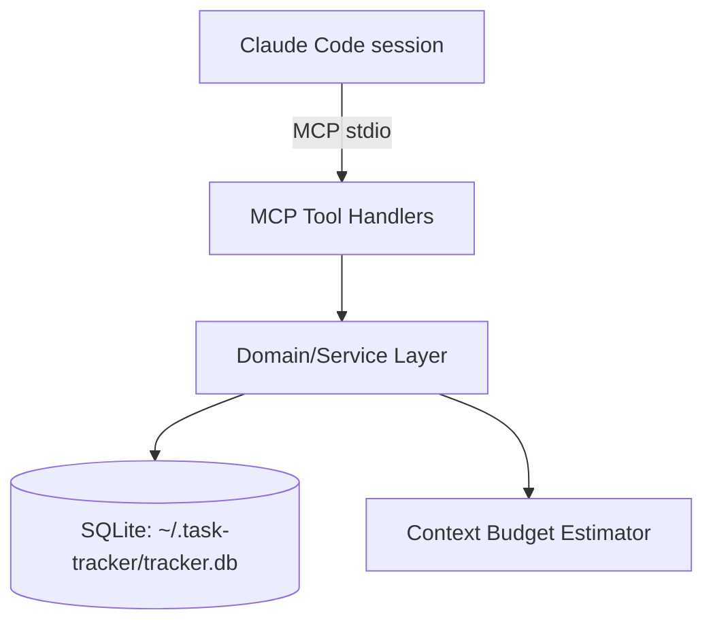
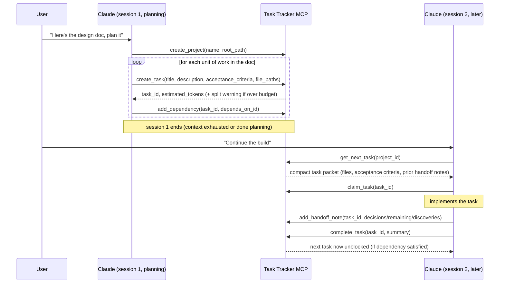
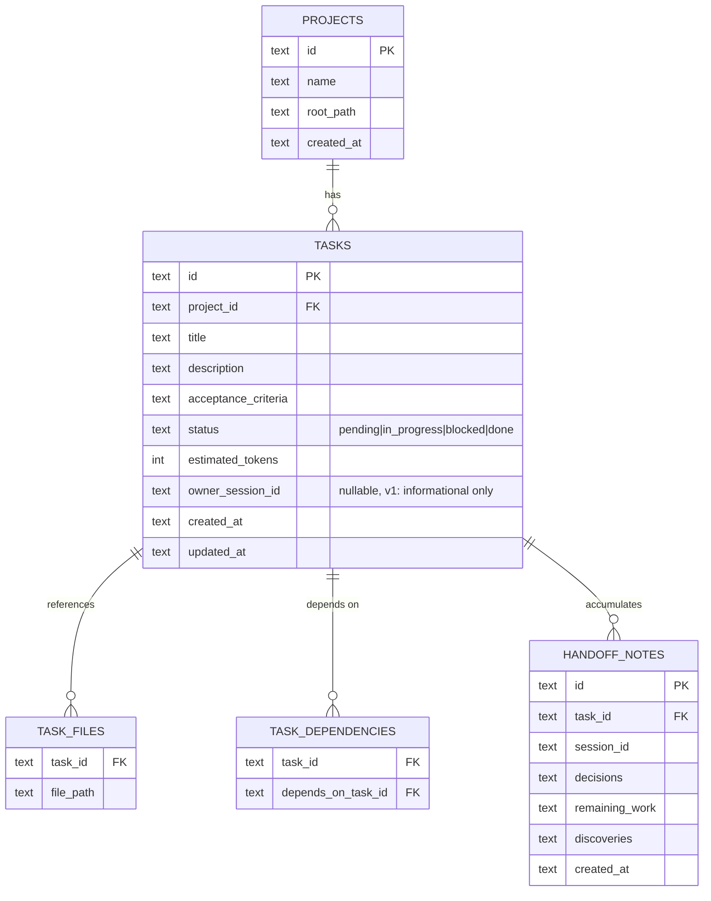

# Task Tracker MCP Server

## Context & Problem

Claude Code builds large applications across many context-limited sessions. Generic
issue trackers (GitHub Issues, Linear, Jira) don't understand context budgets, don't
link tasks to the files an agent needs, and return human-oriented data that wastes
tokens. This project is a local MCP server, purpose-built for agent-driven
development, that Claude Code connects to from any project to plan, size, sequence,
and hand off work across sessions.

## Goals / Non-goals

**Goals**
- Let Claude build a task graph (with dependencies) directly from a design doc, via
  MCP tool calls it makes itself — no server-side document parsing.
- Give each task an explicit file/module list so a new session doesn't have to
  rediscover it.
- Estimate the context cost of a task and support splitting tasks that are too big.
- Return compact, pre-filtered MCP responses (not human-issue-tracker formatting).
- Resolve "what's the next task" strictly from the dependency graph.
- Persist structured handoff notes (decisions, remaining work, discoveries) per task,
  so a fresh session resumes from a summary instead of re-deriving context.
- Work across multiple projects from one running server instance.

**Non-goals (v1)**
- Verifying completion against real git diffs/test runs — v1 completion is
  Claude-declared (`complete_task`), not verified. Revisit once the basic loop is
  proven.
- True multi-session ownership (stale-lock timeouts, forced reclaim, conflict UI) —
  v1 only guarantees no two callers get the same task from `get_next_task` (see
  Failure Modes). Full ownership semantics are v2.
- Auto re-sync when the design doc changes after the graph is generated — v1 assumes
  Claude edits the graph manually to reflect doc changes.
- A UI. v1 is MCP-tools-only; a CLI/viewer can be added later without touching the
  core.

## Constraints

- Runs locally as a single long-lived process per machine, connected to Claude Code
  over the MCP stdio transport — no network exposure, no auth needed.
- Must serve multiple projects from one server instance (chosen over one-server-
  per-project) so it can be registered once, like the global `CLAUDE.md`.
- Stack: TypeScript/Node.js (official MCP SDK, good ecosystem fit) + SQLite (gives
  transactions and queryable dependency graph without building either from scratch).
- Single operator, single machine — no distributed-systems concerns (no need for the
  server to survive a different machine's crash, no multi-region, etc.).

## Chosen Approach

One MCP server process, one SQLite database at `~/.task-tracker/tracker.db` shared
across all projects (`project_id` as a column, not a separate DB per project). Claude
itself is the "importer": it reads a design doc and calls `create_task` /
`add_dependency` repeatedly — the server never parses markdown, which keeps it simple
and keeps task quality tied to Claude's own understanding of the doc rather than a
brittle parser. A thin domain/service layer sits between the MCP tool handlers and
SQLite so the business logic (graph resolution, budget estimation) is testable
independent of the MCP transport.

## Components

- **MCP Tool Handlers** — thin adapters: validate input, call the domain layer,
  shape the compact response. No business logic here.
- **Domain/Service Layer** — task CRUD, dependency graph resolution ("next
  unblocked task"), split/merge logic, handoff-note persistence. Framework-agnostic,
  unit-testable without an MCP client.
- **Context Budget Estimator** — given a task's `file_paths`, estimates token cost
  (chars-on-disk / 4 as a first heuristic) and flags tasks over a configurable
  threshold (e.g. 15k tokens) as "should split" in tool responses. Isolated behind
  an interface so the heuristic can be swapped later without touching callers.
- **SQLite** — single file, WAL mode (safe concurrent reads, serialized writes).

## Data Flow

## Data Model

`status = blocked` is derived, not stored authoritatively — `get_next_task` and
`list_tasks` compute it from unmet dependencies at query time, so it can't drift out
of sync with the graph.

## Interfaces

All responses are compact JSON — no HTML/markdown formatting, no metadata Claude
didn't ask for.

- `create_project(name, root_path) -> { project_id }`
- `create_task(project_id, title, description, acceptance_criteria, file_paths[], depends_on?: task_id[]) -> { task_id, estimated_tokens, over_budget: bool }`
- `add_dependency(task_id, depends_on_task_id) -> { ok: true }` (rejects if it would create a cycle)
- `split_task(task_id, subtasks: [{title, description, acceptance_criteria, file_paths}]) -> { new_task_ids[] }` — original task is replaced; its dependents and dependencies are rewired onto the subtasks.
- `get_next_task(project_id) -> { task } | { task: null, reason: "all_done" | "all_blocked", blocked_on?: [...] }` — atomically marks the returned task `in_progress` as part of the same transaction that selects it (the v1 answer to concurrent callers, see Failure Modes).
- `claim_task(task_id, session_id) -> { ok: true }` — records `owner_session_id`; informational in v1, not enforced as a hard lock.
- `add_handoff_note(task_id, session_id, { decisions, remaining_work, discoveries }) -> { ok: true }`
- `complete_task(task_id, summary) -> { ok: true, unblocked_task_ids: [...] }`
- `get_project_status(project_id) -> { total, done, in_progress, blocked, pending, percent }`
- `list_tasks(project_id, status?) -> { tasks: [{ id, title, status, estimated_tokens }] }` — summary rows only; use `get_next_task`/a future `get_task` for full detail.

## Failure Modes & Edge Cases

- **Two `get_next_task` calls race on the same project.** Selection and the
  `pending -> in_progress` status flip happen inside one SQLite transaction, so the
  same task can't be handed out twice even without full ownership semantics. This is
  the minimum needed to not actively break if the user ever runs two sessions —
  richer conflict handling (stale-lock timeout, explicit reassignment) is v2.
- **Server process crash mid-write.** WAL mode + transactional writes mean the DB
  never sees a half-written task; on restart, state is exactly what was last
  committed.
- **A task's estimate turns out wrong once work starts.** Claude calls `split_task`;
  the remainder becomes new pending tasks that inherit the original's dependency
  edges, so the graph stays consistent.
- **A session dies mid-task without completing or splitting it.** The task stays
  `in_progress` indefinitely. v1 surfaces this passively — `list_tasks` shows it and
  `updated_at` shows staleness — but there's no automatic reclaim; a human (or a
  future v2) has to intervene.
- **Design doc changes after the graph exists.** Not auto-detected; out of scope for
  v1 by design (see Non-goals). Claude has to be told to reconcile manually.
- **`add_dependency` would create a cycle.** Rejected synchronously with an error;
  the domain layer checks reachability before writing.

## Open Questions / Risks

- **Token estimate accuracy.** The chars/4 heuristic is a first cut — if it proves
  too far off in practice (e.g. dense code vs. prose), it's isolated behind the
  Budget Estimator interface and can be swapped for something better without
  touching callers.
- **Git-diff-based completion verification (gap #6 from the original discussion)**
  is deferred past v1. Confirm you're fine building the habit of trusting
  Claude-declared completion first, before we add the verification layer.
- **Locking/ownership (gap #8)** is deferred past full semantics in v1 — only the
  atomic "no duplicate hand-out" guarantee is in from the start. Confirm this is
  enough until you're actually running concurrent sessions regularly.
- **No viewer/CLI in v1.** If you want to eyeball project status without going
  through Claude, that's a small addition later (read-only, sits on top of the same
  domain layer).
